# Tutorial: from an empty project to a pack

English · [繁體中文](tutorial.zh-TW.md)

This tutorial starts from an empty project and makes, by yourself, the pack of the [fish pond demo](https://github.com/wrbyhaquc/inspector-demo-pond):
one camera watches a pond; when the fish come up gasping the aerator goes on, a heron is scared away, the pump runs
when the water is low and the fish are fed morning and evening - then it becomes a pack that runs on another computer.
No code and no model to train; about an hour.

On the way you go through the whole of Inspector: **connect a picture → define the states to watch → check how well
they are judged → write scripts → run → an operation panel for the people on site → deliver**.
With a scene of your own (another camera, an app's window, a phone) the steps are the same.

> Stuck? The pond repository's `pack/build.py` makes this very pack in one go with the same settings: it is the
> answer key of this tutorial.

**Contents**

1. [Get ready](#1-get-ready)
2. [Connect the camera](#2-connect-the-camera)
3. [Record a while](#3-record-a-while)
4. [Define the states to watch](#4-define-the-states-to-watch)
5. [Answer questions: how well is it judged?](#5-answer-questions-how-well-is-it-judged)
6. [An output: how equipment is driven](#6-an-output-how-equipment-is-driven)
7. [Sub-scripts: one action each](#7-sub-scripts-one-action-each)
8. [The main script: what to do when](#8-the-main-script-what-to-do-when)
9. [Run](#9-run)
10. [Schedules: feeding on time](#10-schedules-feeding-on-time)
11. [The operation panel: for the people on site](#11-the-operation-panel-for-the-people-on-site)
12. [Export the pack, install it elsewhere](#12-export-the-pack-install-it-elsewhere)

---

## 1. Get ready

1. Install the **Studio** as the [README](../README.md#install-and-start) says (designing needs the Studio; a Runtime only runs).
2. Get the pond demo and start its simulator; leave it running:
   ```bash
   git clone https://github.com/wrbyhaquc/inspector-demo-pond
   cd inspector-demo-pond
   python sim/server.py            # http://127.0.0.1:8800/ is the simulator's control room
   ```
   The control room's "Demo" buttons (Night now, Heron now, Water low…) make things happen whenever you want.
3. Start Inspector (`start.bat` or `python -m server`) and open http://127.0.0.1:8765.
4. On **Home**, fill in the "Project" card:
   - Name: `Fish pond`
   - Description: `A fish pond watched by one camera`
   - A device is called: `camera` (the pages then say camera wherever they said device)

   and Save. The pack's name and description follow.

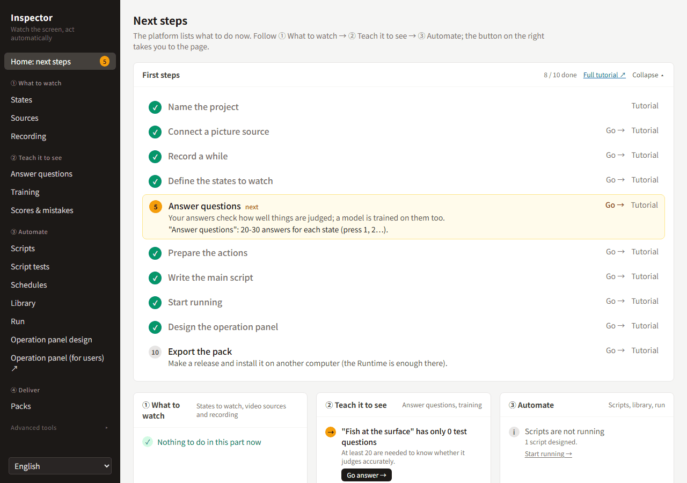

Home's "First steps" card is this tutorial's route: each stop is ticked once done, the next one is marked in yellow, and each links to its chapter here.
The "What this page is for" card at the top of each page says what the page is for and where to start; "Got it" puts it away.

## 2. Connect the camera

**① What to watch › Sources**

1. Press "+ Add source". The top part scans this computer for devices (emulators, windows, screens); a camera is not
   found that way: add it by its address at the bottom.
2. Press "+ HTTP video (MJPEG / snapshot URL)" and fill in:
   - Name: `Pond camera`
   - ID: `POND-CAM` (scripts and schedules use it; it cannot change later)
   - Stream address: `http://127.0.0.1:8800/video.mjpg`
3. Press "Add". When the list shows "Pond camera · Found", it is connected.

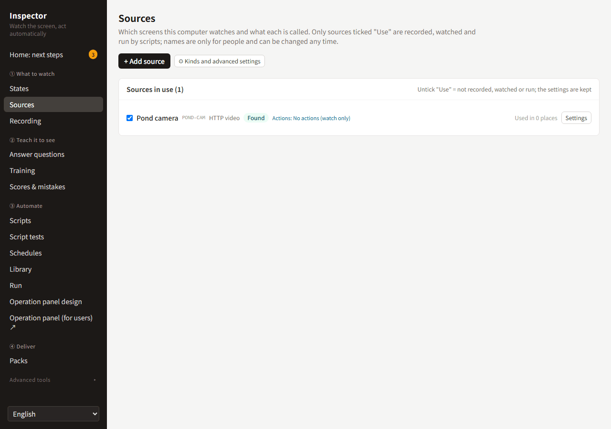

A camera only watches; it cannot click. Equipment is driven through an "output" later.

## 3. Record a while

**① What to watch › Recording**

Recorded frames are used twice: to try the rules and check how well they judge while you define the states, and to
teach a model later if one is ever needed.
**The recording must cover every situation you want recognized**: what was never recorded cannot be checked.

1. Set "Auto stop (minutes)" to `8` and press "Start recording".
2. While it records, make things happen in the simulator's control room:
   - **Night now**: by night the oxygen slowly falls; wait until the fish come up gasping (about a minute) and let
     them stay up for a while;
   - turn the Aerator on: foam and spray;
   - **Heron now** (a heron lands), then **Scare** a little later;
   - **Day now**, **Rain now**, **Water low** (the level drops), then run the Pump for a while.
3. It stops by itself. On Home, "Frame samples" grows (about one frame every 3 seconds).

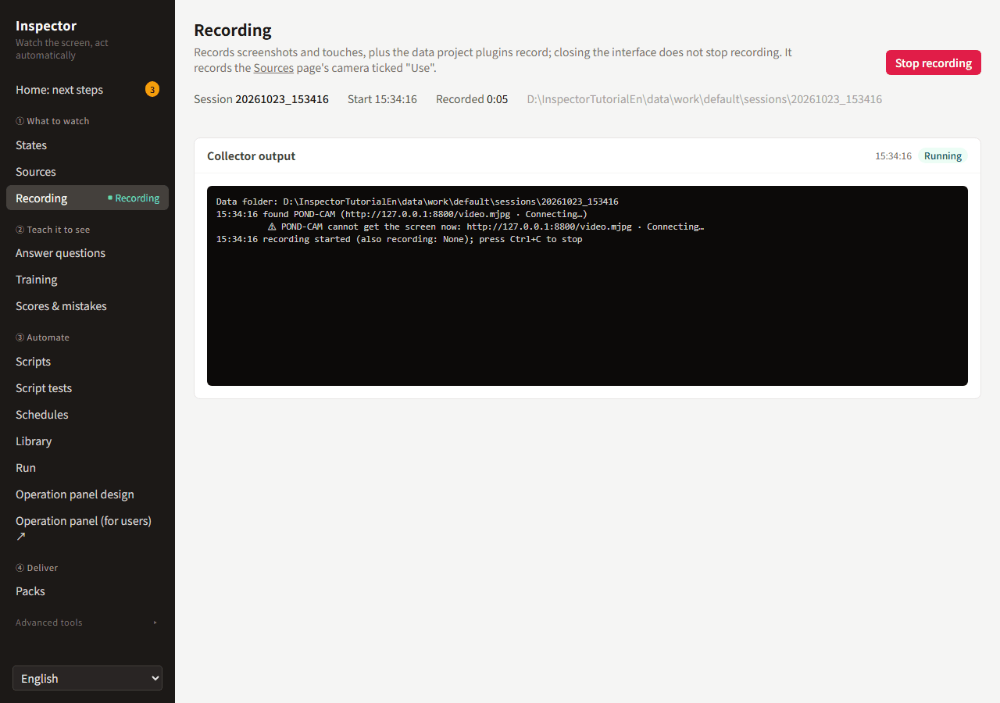

## 4. Define the states to watch

**① What to watch › States**

A "state" is what scripts ask about: "are the fish at the surface?", "how high is the water?". Each state looks at one
area of the picture and has its own answers.
Every state of this pond can be judged by a **screen rule** (count how much of a colour there is, measure how full a
bar is), so no model needs training.

### 4.1 Fish at the surface (colour ratio)

1. Press "+ Add state" and fill in:
   - Display name: `Fish at the surface`; Description: `Fish come up gasping when the water is short of oxygen`
   - Type: **Class**; Label source: **Screen rule**
2. **Class options**: name `yes` `Yes` and `no` `No`.
3. **Crop areas**: drag over the middle of the water on the picture, or type x `260`, y `250`, width `740`, height `330`.
   Below, other frames show what this area looks like: check that it keeps clear of the bank and the aerator.
4. In **Rule settings** choose "**Color ratio**":
   - "1. Color to count": on the zoomed picture, **click a bright orange fish at the surface**; a colour range is added.
     Tick "Mark matching pixels" and check that the fish turn pink and the water and the bank do not. Or type
     hue `250`–`27`, saturation `120`–`255`, value `100`–`255`.
   - "2. Thresholds": anything for now, e.g. Ratio ≥ `0.01` → Yes, Ratio ≤ `0.005` → No.
   - "3. Check on 200 frames": press "**Analyze**". The bars show how the frames' ratios spread.
5. **Set the thresholds from the bars.** The ideal picture is two groups with an empty gap between them: the
   thresholds go into the gap. Here the frames without fish at the surface are all at 0% and those with them at about
   0.6%–0.8%, so set Ratio ≥ `0.004` → Yes and Ratio ≤ `0.002` → No and press "Analyze" again.
   "**Suggested thresholds**" under the bars finds the empty stretch between the groups (once you have answered
   questions, from your answers: none of them comes out wrong); "Use the suggestion" fills them in. Use it when the
   bars agree.

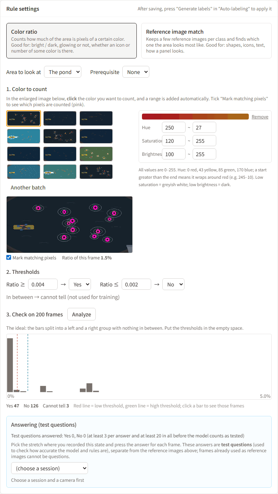

Frames between the two thresholds are "undecided" - the few seconds when the fish are only starting to come up, for
example. A script waits on an undecided state instead of guessing, so a gap between the thresholds is a good thing.

### 4.2 The other class states

Made like the first, with other areas, colours and thresholds (press "Analyze" for each and adjust to its bars):

| Display name | Classes (value → name) | Area x, y, width, height | Colour: hue / saturation / value | Ratio ≥ → | Ratio ≤ → |
|---|---|---|---|---|---|
| Aerator running | yes → Running, no → Stopped | 270, 385, 180, 90 | 0–255 / 0–35 / 100–255 (white foam) | 0.06 → Running | 0.03 → Stopped |
| Heron | yes → There, no → None | 280, 140, 720, 115 | 0–255 / 0–40 / 130–255 (a white bird) | 0.02 → There | 0.01 → None |
| Day or night | day → Day, night → Night | 420, 0, 560, 70 | 0–255 / 0–255 / 110–255 (a bright sky) | 0.6 → Day | 0.2 → Night |

### 4.3 Water level (bar ratio)

1. "+ Add state": Display name `Water level`, Type **Ratio 0–1**, Label source **Screen rule**.
2. The area is the inside of the level tube on the right bank only: x `1181`, y `251`, width `22`, height `198` (from the
   empty end to the full end, not its frame).
3. Choose the "**Bar ratio**" rule: "**Fills bottom to top**", fill colour automatic; open "Advanced settings…" and
   untick "Skip white text on the bar" (the tube is white inside).
4. Press "**Measure on 24 frames**": each measure must match the level in its picture.

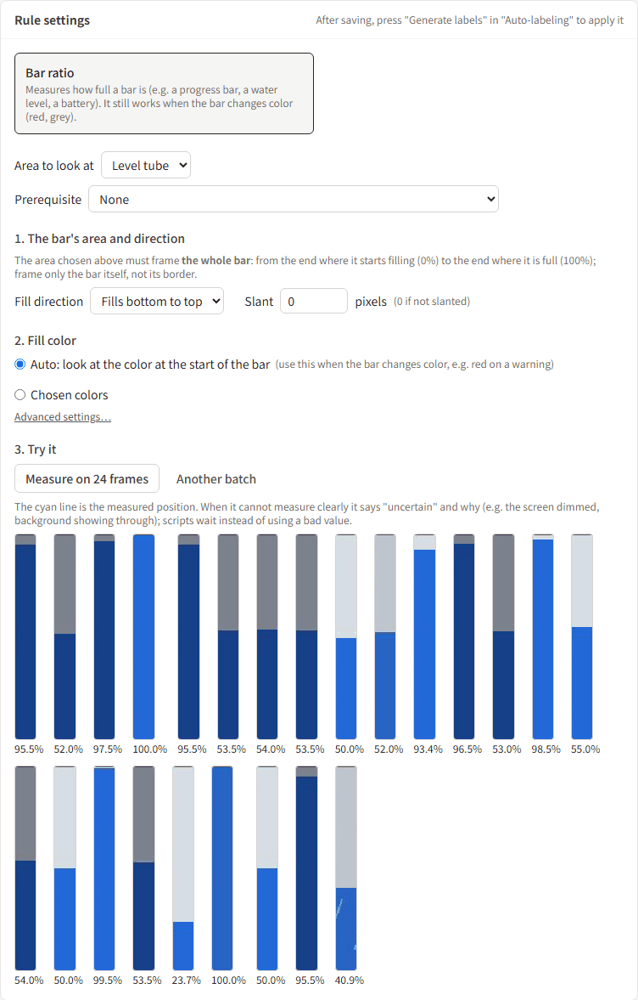

Finally press "**Save**" at the top of the page (with a line about the change if you like). Every save is a new
version; "Version history" lists them.

## 5. Answer questions: how well is it judged?

**② Teach it to see › Answer questions**

How well a screen rule judges is checked against answers you give yourself. They are the "test questions": the
accuracy of rules and models is measured on them, and for a rule marked "Urgent" in a script (it acts the first time it
sees its condition) the platform reminds you that the states it uses need at least 30.

1. Choose "All frames (incl. answered)" and in "Ask only one question" pick "Fish at the surface".
2. Press `1` (Yes) or `2` (No) for each frame; "Cannot tell for this question" when something covers it. When the
   questions run out, "Add 30 "Fish at the surface" questions".
3. Answer 20–30 for each of the other states too.

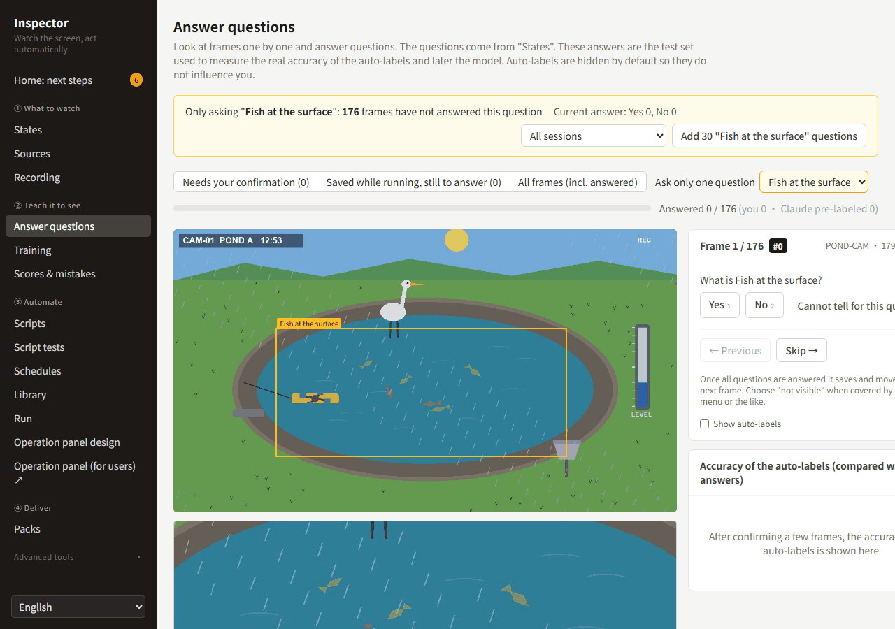

**Train a model?** Not for this pond: every state has a reliable screen rule. When a picture is too complex for rules
(shapes, text, people), "② Teach it to see › Training" trains a model on the answers, and the model and the rules
check each other.

## 6. An output: how equipment is driven

**③ Automate › Library › Output**

Scripts drive things outside the screen through outputs: HTTP, MQTT, Home Assistant. The simulator's equipment is an
HTTP service.

1. Press "+ Add output" and fill in its row: name `Pond equipment`, ID `pond`, kind "**URL (HTTP / Webhook)**", URL
   `http://127.0.0.1:8800/api/command`, **POST**.
2. "Test" sends a test message: the simulator's log shows `command: test`. A test goes out while the runner runs - try
   it after chapter 9 if you like.

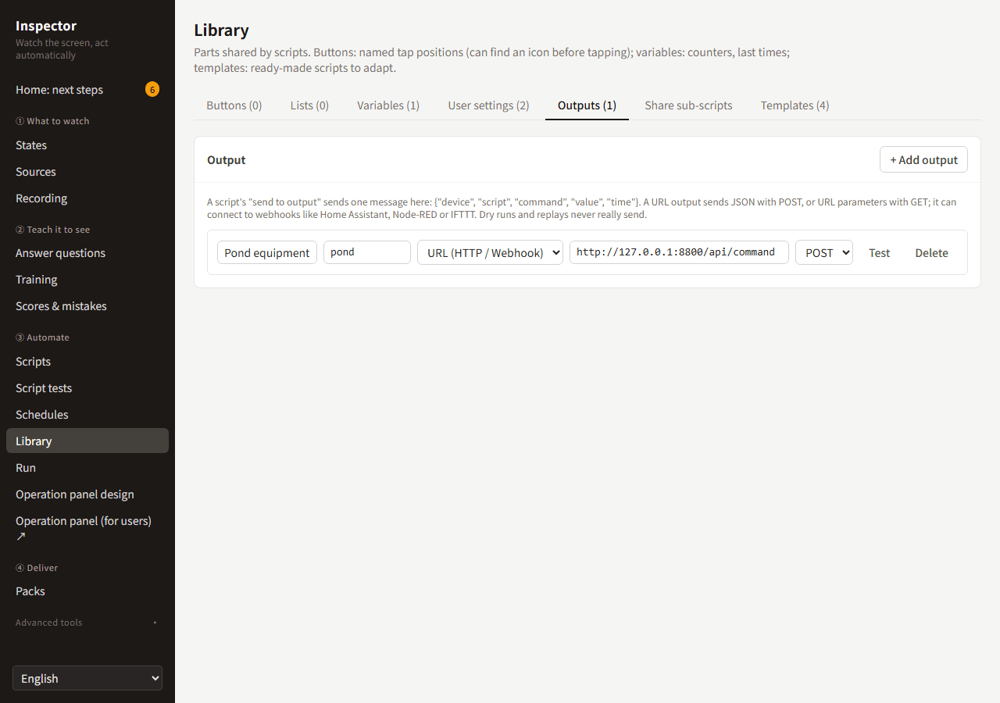

Each message is JSON like `{"command": "aerator_on", ...}`; the simulator (or your real equipment's gateway) acts on
`command`.

## 7. Sub-scripts: one action each

**③ Automate › Scripts**, the sub-script library at the bottom left

A sub-script is a list of steps used again and again: main scripts, schedules and the operation panel's buttons call it.

1. "+ Add sub-script", named `Start the aerator`.
2. "+ Add step" → **Send to output**: output `Pond equipment`, command `aerator_on`.
3. "+ Add step" again → **Notify**: `Aerator started`.
4. Save.

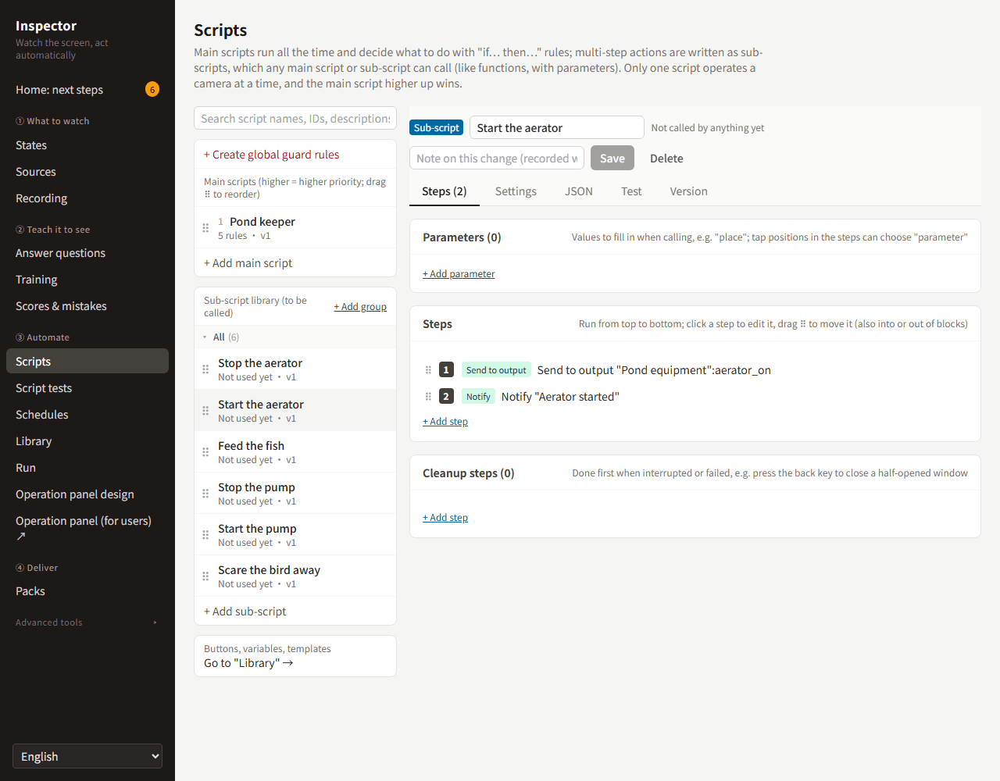

Make five more the same way: `Stop the aerator` (aerator_off), `Start the pump` (pump_on), `Stop the pump` (pump_off),
`Feed the fish` (feed), `Scare the bird away` (scare).

## 8. The main script: what to do when

**③ Automate › Scripts**

A main script runs all the time: at every look it checks its rules from the top, and the **first one that holds** does
its steps.

1. "+ Add main script", named `Pond keeper`.
2. In its situation `Watching the pond`, "+ Add rule" for each of these (join conditions with "+ And (another
   condition)"; "for N seconds" keeps a moment's misjudgement from acting):

| # | Rule | If | Then, in order | Cooldown |
|---|---|---|---|---|
| 1 | Fish at the surface: start the aerator (tick "Urgent") | Fish at the surface = Yes (for 3 s) and Aerator running = Stopped | Send to output "Pond equipment": aerator_on → Notify "Fish at the surface: the aerator is on" | 20 s |
| 2 | Heron at the pond: scare it | Heron = There (for 2 s) | Send to output: scare → Notify "A heron was at the pond: scared it away" | 15 s |
| 3 | Water low: start the pump | Water level < setting "Pump on below" (for 5 s) and variable "Pump started by the script" = 0 | Send to output: pump_on → set the variable to 1 → Notify | 60 s |
| 4 | Water back up: stop the pump | Water level > setting "Pump off above" (for 5 s) and the variable = 1 | Send to output: pump_off → set the variable to 0 → Notify | 60 s |
| 5 | Daylight and fish fine: stop the aerator | Day or night = Day (for 30 s) and Fish at the surface = No (for 60 s) and Aerator running = Running (for 10 s) | Send to output: aerator_off → Notify | 60 s |

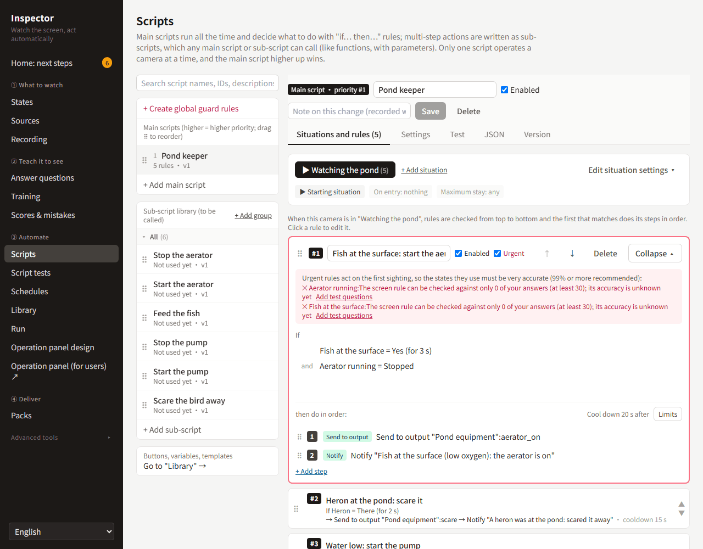

Rules 3 and 4 use two things made in the **Library** first:
- **User settings**: `Pump on below` (a number, 0.3 to begin with) and `Pump off above` (0.75). Their values are
  changed by the people on site on the operation panel, not in the script.
- **Variable**: `Pump started by the script` (per device, starting at 0): it remembers whether the script started the
  pump, so it never stops a pump someone started by hand.

Saved, every rule reads as a sentence:

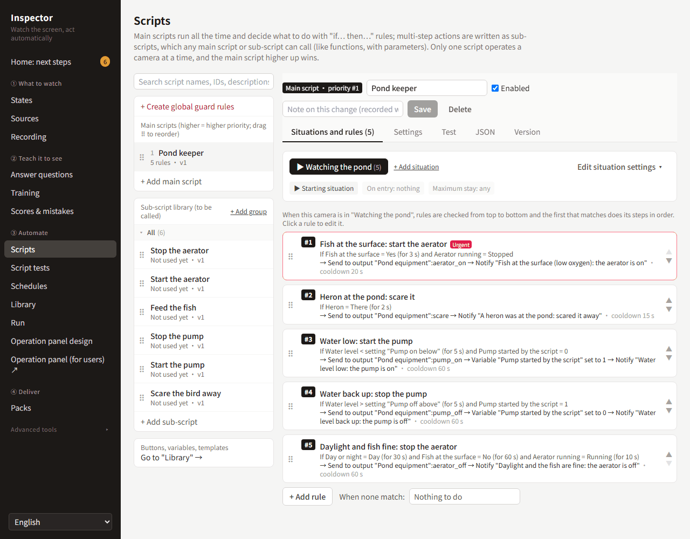

## 9. Run

**③ Automate › Run**

1. "**Deploy**" tab: "Pond keeper" runs **Live** on "Pond camera" (a dry run only records what it would do). Save.
   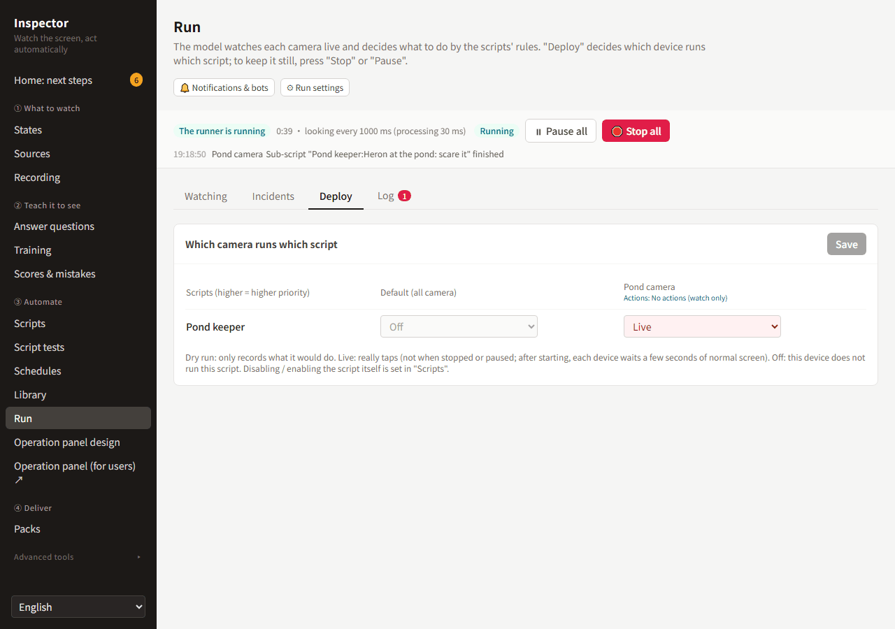
2. Press "Start" at the top (it looks every 1000 ms by default).
3. "Watching" shows the camera and what it is doing. "**Details**": every state's value now (and what judged it),
   each rule's decision, a timeline.
   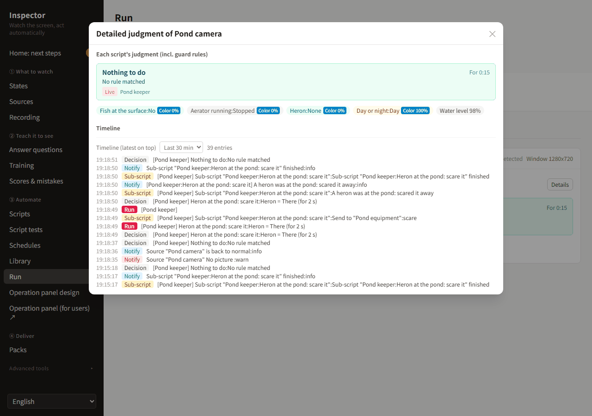
4. In the simulator press **Night now**: about a minute later the fish come up and the aerator goes on by itself;
   **Heron now**: within seconds the heron is scared away; **Water low**: the pump starts.

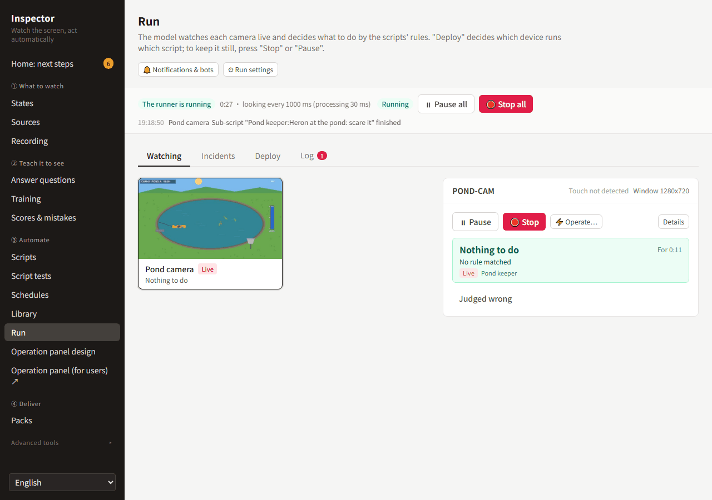

"Stop" or "Pause" holds it; every real action is in the "Log".

> **Try it on the recording first**: "Sources › + Add source", under "Recording replay" tick "This project's recordings" and scan: the stretch recorded in
> chapter 3 is a source, played in the recorded timing and looped. Dry-run the script on it and "Details" shows what it
> would do when the fish come up or the heron lands, without waiting for either. The recorder does not record it again.

## 10. Schedules: feeding on time

**③ Automate › Schedules**

1. "+ Add schedule": `Morning feeding`, daily at `08:00`, tick "Pond camera", run sub-script `Feed the fish`.
2. Another, `Evening feeding`, at `17:00`.
3. Save. Schedules follow the computer's clock.

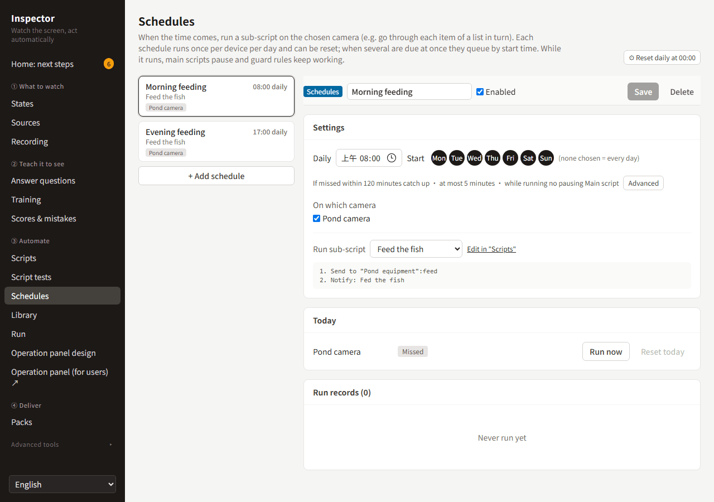

## 11. The operation panel: for the people on site

**③ Automate › Operation panel design**

The people on site need neither scripts nor states: how things are now, a few buttons, a few settings. The operation
panel is their page, phones included.

1. "+ Add a settings block" - one block per thing they think about:
   - "Equipment": action buttons that run sub-scripts (start the aerator, stop it, start the pump, feed now…);
   - "Water level": wired to the user settings "Pump on below" and "Pump off above";
   - "Feeding times": wired to the schedules' switches and start times.
2. "Or add a monitor widget:": "Device status" (how each camera is, with "Small live screen"), "Log",
   notifications and commands (Discord / Telegram).
3. "Tabs" put the blocks on "Now", "Settings" and "Notifications".
4. The "Layout" card is how a wide screen shows it: drag blocks to order them (onto a tab: to that page) and drag a
   block's right edge to change its width (a third, half, two thirds, the full row). Phones show one column.

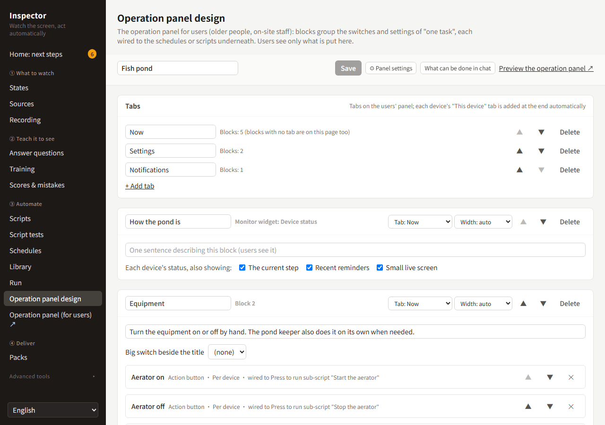

**Operation panel (for users) ↗** is what the people on site see:

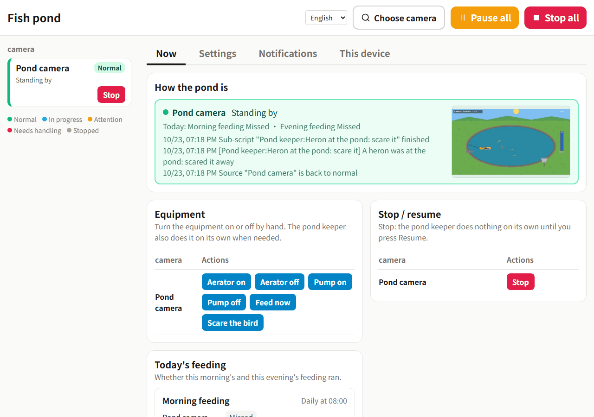

## 12. Export the pack, install it elsewhere

**④ Deliver › Packs**

1. "Export a release": check the name, the version (e.g. `1.0.0`) and the description, look at the checks (deal with
   anything marked ✗ first), press "Export", then download it.
2. On another computer (a **Runtime** is enough, no PyTorch): **Packs › Install or upgrade**, choose the zip, restart
   when asked.
3. Connect its camera under "Sources" there and "Run › Start". What the people there change on the operation panel
   stays on that computer, through newer versions of the pack too.

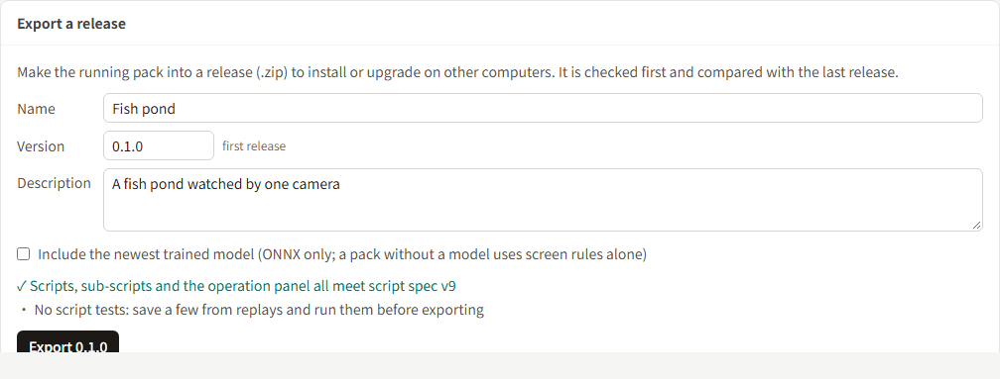

---

**Next**

- So that others can install it and use it straight away, a pack can declare the sources it uses (a camera's address)
  and how it is meant to run in `project.json`: see `pack/build.py` of the pond, the
  [small farm](https://github.com/wrbyhaquc/inspector-demo-farm) and [whack-a-mole](https://github.com/wrbyhaquc/inspector-demo-whack-a-mole).
- Two or more cameras with different pictures: a state can be "Only on these sources" (the small farm).
- To click on a screen (an app, an emulator, a window) instead of driving equipment: the source itself is the hand,
  sub-scripts use a "tap" step and the places are buttons in the Library (whack-a-mole).
- Every part in full: the [README](../README.md) and [How scripts work](scripts.md).
