# 教學:從空白專案做出一個方案包

[English](tutorial.md) · 繁體中文

這份教學帶你從一個空白專案開始,自己做出 [魚塭示範](https://github.com/wrbyhaquc/inspector-demo-pond) 的方案包:
一台攝影機看著魚塭,魚浮頭就開打氣機、白鷺鷥來了就趕走、水位低就抽水、早晚定時餵魚,最後做成方案包,裝到另一台電腦執行。
全程不用寫程式,也不用訓練模型,大約一小時。

做完之後,你會走過 Inspector 的整條路:**接上畫面 → 定義要看的狀態 → 檢查它判斷得準不準 → 寫腳本 → 執行 → 給使用者的操作面板 → 交付**。
換成你自己的場景(另一台攝影機、一個 App 視窗、一台手機)時,步驟都一樣。

> 卡住時,可以對照魚塭 repo 的 `pack/build.py`:它用同樣的設定一次做出整個方案包,是這份教學的「解答」。

**目錄**

1. [準備](#1-準備)
2. [接上攝影機](#2-接上攝影機)
3. [錄一段畫面](#3-錄一段畫面)
4. [定義要看的狀態](#4-定義要看的狀態)
5. [回答問題:檢查判斷準不準](#5-回答問題檢查判斷準不準)
6. [輸出:控制設備的方式](#6-輸出控制設備的方式)
7. [子腳本:一件一件的動作](#7-子腳本一件一件的動作)
8. [主腳本:什麼時候做什麼](#8-主腳本什麼時候做什麼)
9. [執行](#9-執行)
10. [排程:定時餵魚](#10-排程定時餵魚)
11. [操作面板:給現場的人用](#11-操作面板給現場的人用)
12. [匯出方案包,裝到另一台](#12-匯出方案包裝到另一台)

---

## 1. 準備

1. 依 [README](../README.zh-TW.md#安裝與啟動) 裝好 **Studio**(要設計就要 Studio;Runtime 只能執行)。
2. 下載魚塭示範,啟動模擬器,讓它一直開著:
   ```bash
   git clone https://github.com/wrbyhaquc/inspector-demo-pond
   cd inspector-demo-pond
   python sim/server.py            # http://127.0.0.1:8800/ 是模擬器的監控室
   ```
   監控室右邊的「Demo」按鈕(Night now、Heron now、Water low…)可以隨時製造狀況,等一下會用到。
3. 啟動 Inspector(`start.bat` 或 `python -m server`),打開 http://127.0.0.1:8765 。
4. 在 **首頁** 的「專案」卡片填:
   - 名稱:`魚塭`
   - 說明:`一台攝影機看著的魚塭`
   - 一台叫做:`攝影機`(頁面上的「裝置」都會改叫攝影機)
   按「儲存」。方案包的名稱和說明也會跟著改。

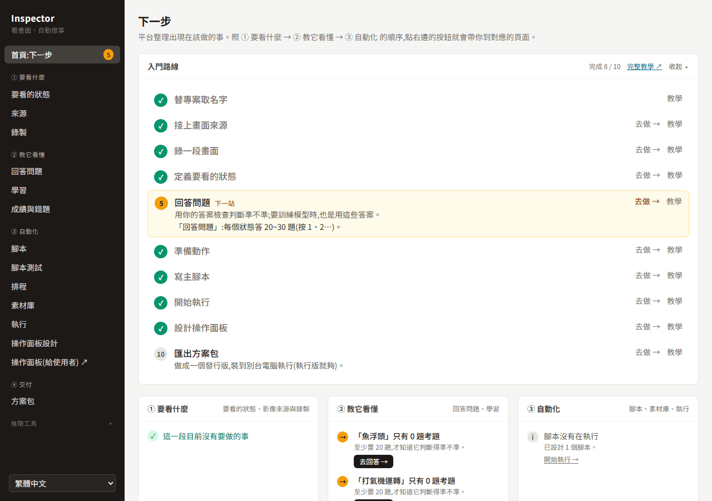

首頁的「入門路線」就是這份教學的路:每一站做完會打勾,下一站標黃色,旁邊連到教學的那一章。
每頁最上面的「這頁是做什麼的」說明這頁的用途和從哪裡開始,看過按「知道了」就不再出現。

## 2. 接上攝影機

**① 要看什麼 › 來源**

1. 按「+ 加入來源」。上面是掃描這台電腦上的裝置(模擬器、視窗、螢幕);攝影機掃不到,用最下面的位址加入。
2. 按「+ HTTP 影像(MJPEG / 快照網址)」,填:
   - 名稱:`魚塭攝影機`
   - 代號:`POND-CAM`(腳本、排程都用它,之後不能改)
   - 串流位址:`http://127.0.0.1:8800/video.mjpg`
3. 按「加入」。來源清單出現「魚塭攝影機 · 找得到」就接好了。

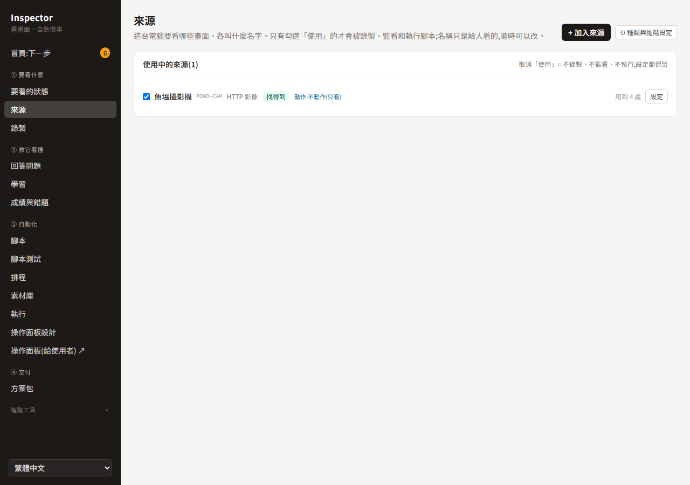

攝影機只能「看」,不能點擊;要控制設備,等一下用「輸出」。

## 3. 錄一段畫面

**① 要看什麼 › 錄製**

錄下來的畫面有兩個用處:定義狀態時拿來試規則、檢查準不準;之後要訓練模型時當教材。
**錄到的畫面要涵蓋每一種你想讓它認得的狀況**,沒錄到的狀況就無從檢查。

1. 「自動停止(分鐘)」填 `8`,按「開始錄製」。
2. 錄製的同時,到模擬器的監控室依序製造狀況:
   - **Night now**:晚上溶氧會慢慢下降,等魚浮到水面喘氣(大約一分鐘),讓牠浮一陣子;
   - 按監控室的 Aerator 打開打氣機,看泡沫和水花;
   - **Heron now**(白鷺鷥落地),過一下按 **Scare**;
   - **Day now**、**Rain now**、**Water low**(水位下降),再打開 Pump 抽一會兒水。
3. 錄完會自動停止。首頁的數字一覽會看到「畫面樣本」增加(大約每 3 秒一張)。

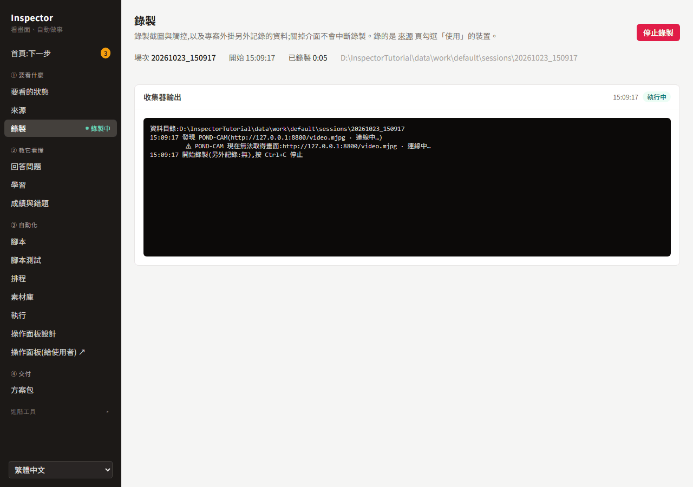

## 4. 定義要看的狀態

**① 要看什麼 › 要看的狀態**

「狀態」是腳本要問的事,例如「魚浮頭了沒」「水位多高」。每個狀態看畫面的一個範圍,有自己的答案。
這個魚塭的狀態都能用**畫面規則**判斷(數某種顏色有多少、量長條多滿),所以不需要訓練模型。

### 4.1 魚浮頭(顏色比例)

1. 按「+ 新增狀態」,填:
   - 顯示名稱:`魚浮頭`;說明:`溶氧不夠時魚浮到水面喘氣`
   - 類型:**分類**;標籤來源:**畫面規則**
2. **類別選項**:把 `yes` 的顯示名稱改成 `有`、`no` 改成 `沒有`。
3. **裁切範圍**:在畫面上拖出池水中間那一塊,或直接填 x `260`、y `250`、寬 `740`、高 `330`。
   下面會列出其他畫面在這個範圍的樣子,確認不會框到岸邊或打氣機。
4. **規則設定** 選「**顏色比例**」:
   - 「1. 要數的顏色」:在放大圖上**點一下浮在水面的亮橘色魚**,會自動加入一個顏色範圍。
     勾「標出符合的像素」,確認魚被標成粉紅色、水和岸沒有。也可以直接填:色相 `250`~`27`、飽和度 `120`~`255`、亮度 `100`~`255`。
   - 「2. 門檻」:先隨便填,例如 比例 ≥ `0.01` → 有、比例 ≤ `0.005` → 沒有。
   - 「3. 用 200 張畫面檢查」:按「**分析**」。長條圖是每張畫面的比例分布。
5. **照長條圖調門檻**。理想的樣子是長條分成兩群、中間空空的,門檻要設在空的地方。
   這次的畫面:沒有魚浮頭的都在 0%,魚浮頭的大約在 0.6%~0.8%,所以改成 比例 ≥ `0.004` → 有、比例 ≤ `0.002` → 沒有,再按一次「分析」。

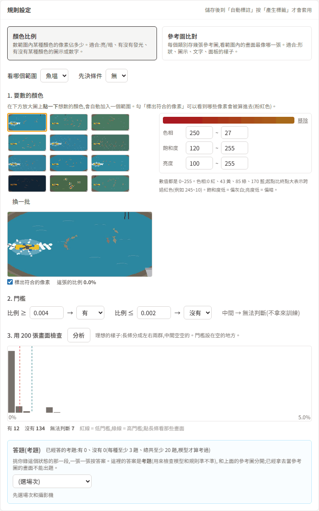

落在兩個門檻之間的畫面算「無法判斷」,例如魚剛開始浮上來的那幾秒。腳本遇到無法判斷會**等**,不會亂猜,所以中間留一段空間是好事。

### 4.2 其他分類狀態

做法和魚浮頭一樣,只是範圍、顏色和門檻不同(每個都先「分析」,再照長條圖微調):

| 顯示名稱 | 類別(值 → 名稱) | 範圍 x, y, 寬, 高 | 顏色:色相 / 飽和度 / 亮度 | 比例 ≥ → | 比例 ≤ → |
|---|---|---|---|---|---|
| 打氣機運轉 | yes → 運轉中、no → 停止 | 270, 385, 180, 90 | 0~255 / 0~35 / 100~255(白色泡沫) | 0.06 → 運轉中 | 0.03 → 停止 |
| 白鷺鷥 | yes → 有、no → 沒有 | 280, 140, 720, 115 | 0~255 / 0~40 / 130~255(白色的鳥) | 0.02 → 有 | 0.01 → 沒有 |
| 白天晚上 | day → 白天、night → 晚上 | 420, 0, 560, 70 | 0~255 / 0~255 / 110~255(亮的天空) | 0.6 → 白天 | 0.2 → 晚上 |

### 4.3 水位(長條比例)

1. 「+ 新增狀態」:顯示名稱 `水位`,類型 **比例 0~1**,標籤來源 **畫面規則**。
2. 範圍只框右岸液位管裡面:x `1181`、y `251`、寬 `22`、高 `198`(從空的那一端框到滿的那一端,不要框到外框)。
3. 規則選「**長條比例**」:填滿的方向「**由下往上填滿**」,填滿的顏色「自動」;打開「進階設定…」,取消「略過長條上的白字」(液位管是白底)。
4. 按「**在 24 張畫面上試量**」,每張的量測要和畫面上的水位相符。

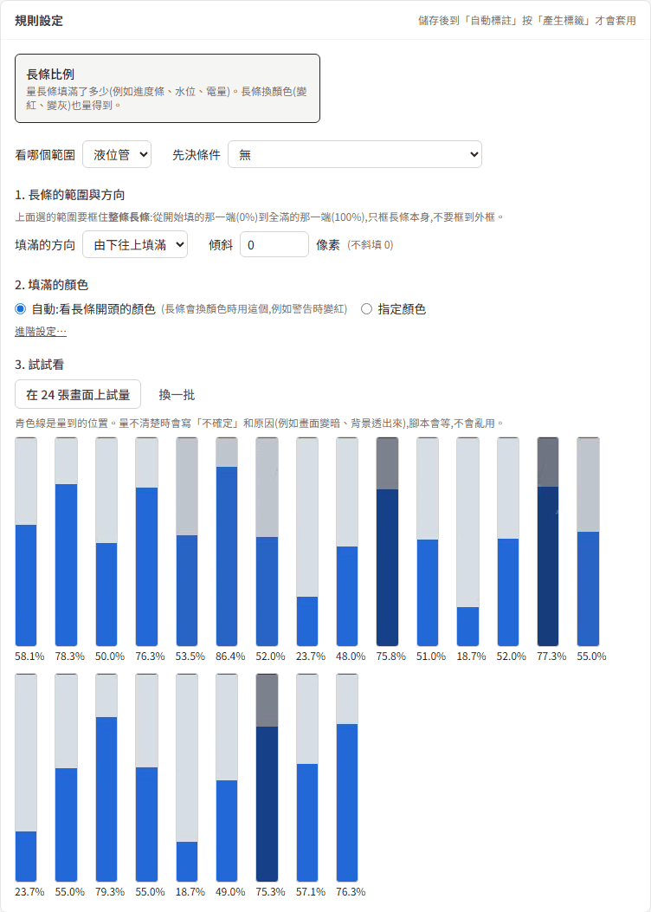

最後按頁面上方的「**儲存**」(可以填一句這次修改的說明)。每次儲存都是一個新版本,「版本紀錄」可以看到。

## 5. 回答問題:檢查判斷準不準

**② 教它看懂 › 回答問題**

畫面規則判斷得準不準,要用你親自回答的題目來檢查。這些答案就是「考題」:
規則或模型的準確率都用它來算;腳本裡標成「緊急」的規則(第一次看到就動作),平台也會提醒它用到的狀態至少要有 30 題。

1. 切到「所有畫面(含已答)」,「只問一題」選「魚浮頭」。
2. 一張一張按 `1`(有)或 `2`(沒有);被擋住看不清楚的選「此題無法判斷」。題目不夠時按「補 30 題」。
3. 其他狀態也各答 20~30 題。

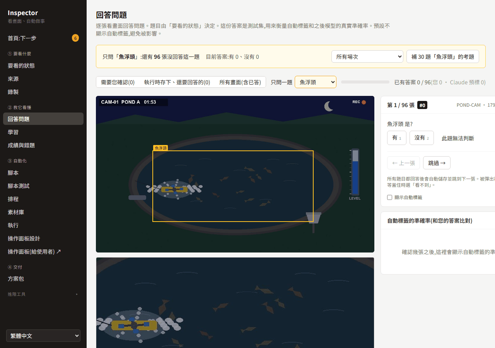

**要不要「學習」(訓練模型)?** 這個魚塭不用:每個狀態都有可靠的畫面規則。
當畫面複雜到規則抓不準(例如要認形狀、文字、人物),才到「② 教它看懂 › 學習」用答案訓練模型;模型和規則會互相把關。

## 6. 輸出:控制設備的方式

**③ 自動化 › 素材庫 › 輸出**

腳本透過「輸出」控制畫面以外的東西:HTTP、MQTT、Home Assistant。模擬器的設備開關就是一個 HTTP 服務。

1. 按「+ 新增輸出」,一列填:名稱 `魚塭設備`、代號 `pond`、種類「**網址(HTTP / Webhook)**」、網址 `http://127.0.0.1:8800/api/command`、**POST**。
2. 按「測試」會送一則測試訊息,模擬器的紀錄會出現 `command: test`。測試要在執行程式開著時才送得出去,做到第 9 章再回來試也可以。

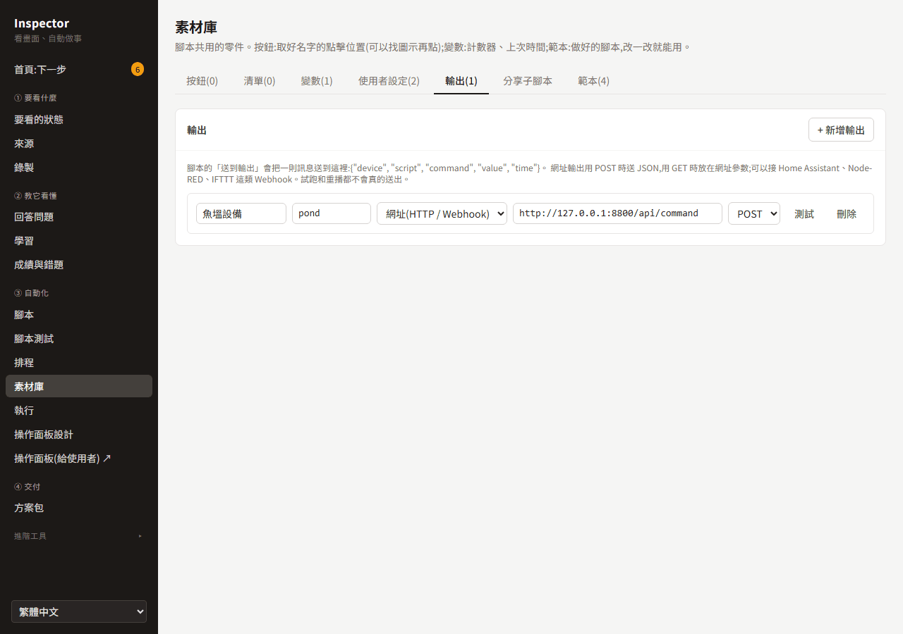

每一則送出的訊息是 `{"command": "aerator_on", ...}` 這樣的 JSON,模擬器(或你真正的設備閘道)照 `command` 動作。

## 7. 子腳本:一件一件的動作

**③ 自動化 › 腳本**,左下的「子腳本庫」

子腳本是一段可以重複使用的步驟,主腳本、排程、操作面板的按鈕都能呼叫它。

1. 按「+ 新增子腳本」,名稱 `開打氣機`。
2. 「+ 新增步驟」→ **送到輸出**:輸出 `魚塭設備`、指令 `aerator_on`。
3. 再「+ 新增步驟」→ **通知**:`打氣機已開`。
4. 按「儲存」。

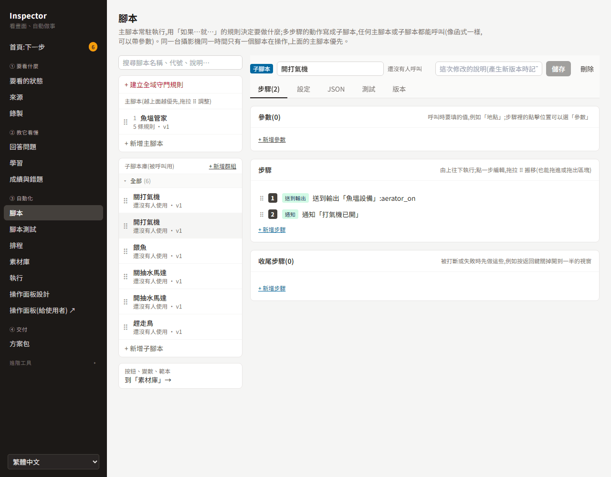

照同樣的做法再做五個:`關打氣機`(aerator_off)、`開抽水馬達`(pump_on)、`關抽水馬達`(pump_off)、`餵魚`(feed)、`趕走鳥`(scare)。

## 8. 主腳本:什麼時候做什麼

**③ 自動化 › 腳本**

主腳本一直在跑:每一次看畫面,就從上往下檢查規則,**第一條成立的**就做它的步驟。

1. 「+ 新增主腳本」,名稱 `魚塭管家`。
2. 在情境「看著魚塭」裡「+ 新增規則」,做出下面這幾條(條件用「+ 而且(再加一個條件)」串起來,「持續 N 秒」可以避開一閃而過的誤判):

| # | 規則 | 如果 | 就依序做 | 冷卻 |
|---|---|---|---|---|
| 1 | 魚浮頭:開打氣機(勾「緊急」) | 魚浮頭 = 有(持續 3 秒)而且 打氣機運轉 = 停止 | 送到輸出「魚塭設備」:aerator_on → 通知「魚浮頭了:已開打氣機」 | 20 秒 |
| 2 | 白鷺鷥來了:趕走 | 白鷺鷥 = 有(持續 2 秒) | 送到輸出:scare → 通知「白鷺鷥來了:已經趕走」 | 15 秒 |
| 3 | 水位低:開抽水馬達 | 水位 < 設定「低於這個水位就抽水」(持續 5 秒)而且 變數「抽水馬達是腳本開的」= 0 | 送到輸出:pump_on → 變數設成 1 → 通知 | 60 秒 |
| 4 | 水位回來:關抽水馬達 | 水位 > 設定「高於這個水位就停止」(持續 5 秒)而且 變數 = 1 | 送到輸出:pump_off → 變數設成 0 → 通知 | 60 秒 |
| 5 | 白天魚也正常:關打氣機 | 白天晚上 = 白天(持續 30 秒)而且 魚浮頭 = 沒有(持續 60 秒)而且 打氣機運轉 = 運轉中(持續 10 秒) | 送到輸出:aerator_off → 通知 | 60 秒 |

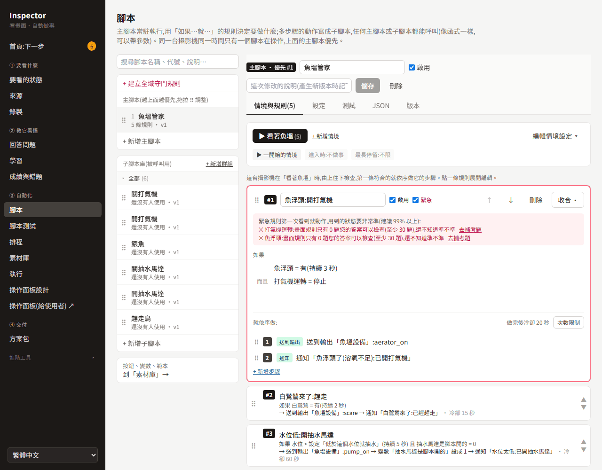

規則 3、4 用到的兩樣東西,先到 **素材庫** 建好:
- **使用者設定**:`低於這個水位就抽水`(數字,預設 0.3)、`高於這個水位就停止`(數字,預設 0.75)。設定的值由使用者在操作面板改,不用改腳本。
- **變數**:`抽水馬達是腳本開的`(每台各自,初始 0),記住抽水馬達是不是腳本自己開的,才不會去關掉別人手動開的。

儲存後,規則都會讀成一句話:

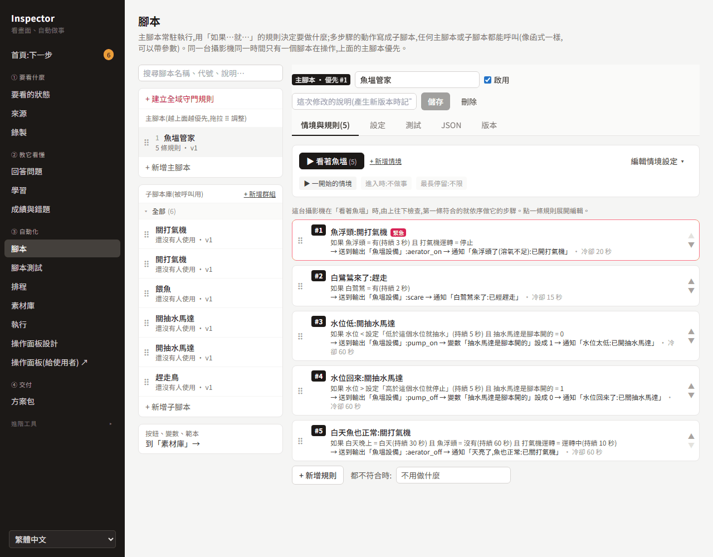

## 9. 執行

**③ 自動化 › 執行**

1. 「**部署**」分頁:讓「魚塭管家」在「魚塭攝影機」上 **正式執行**(試跑只記錄會做什麼,不會真的動作)。按「儲存」。
   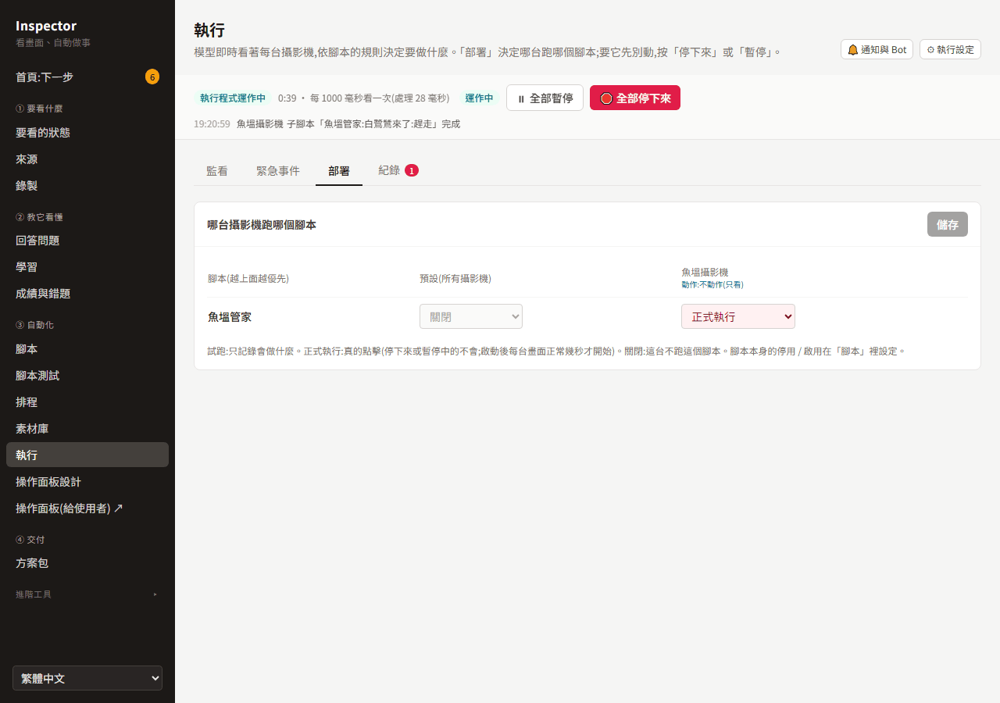
2. 回到上方按「開始」(預設每 1000 毫秒看一次)。
3. 「監看」分頁會看到攝影機的畫面和它現在在做什麼。按「**詳細**」:每個狀態現在的值(和用什麼判斷的)、每條規則的決定、時間軸。
   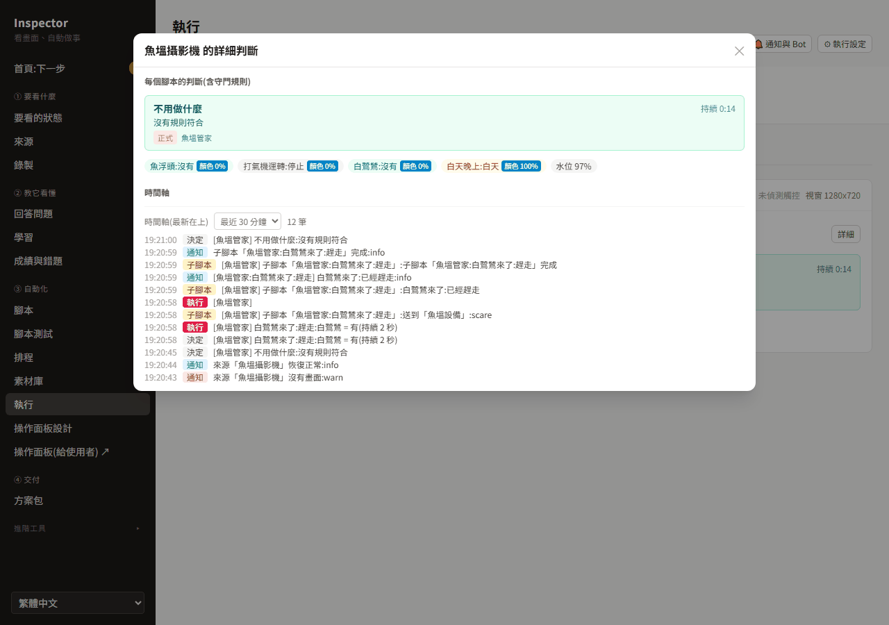
4. 到模擬器按 **Night now**:大約一分鐘後魚浮頭,打氣機就會自己打開;按 **Heron now**,幾秒內白鷺鷥被趕走;按 **Water low**,抽水馬達開始抽水。

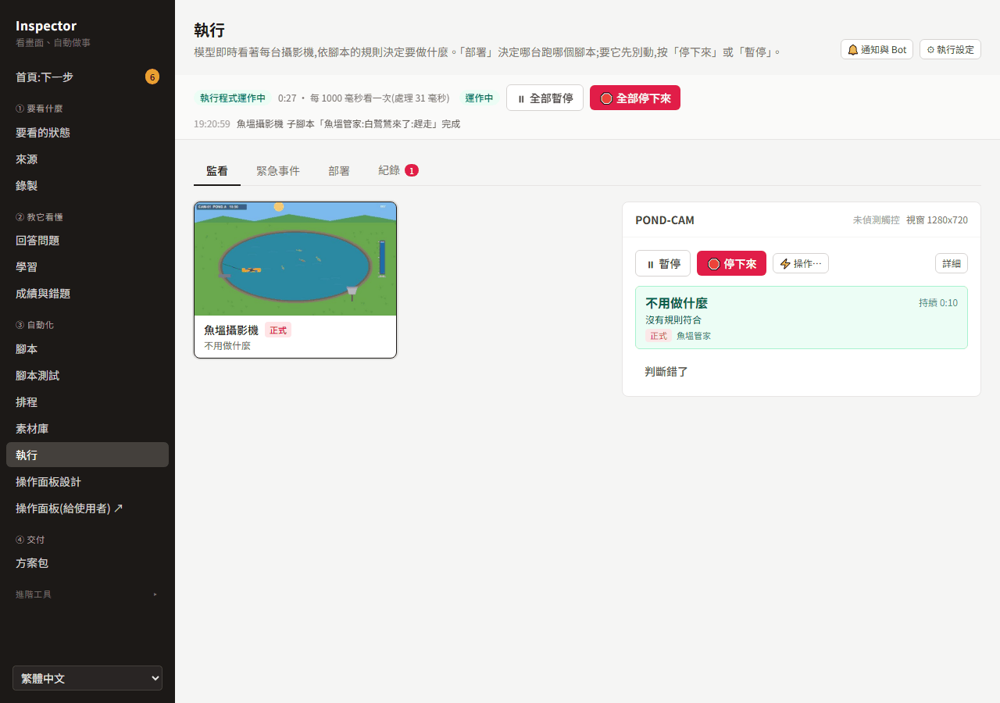

要它先別動,按「停下來」或「暫停」;每一筆真正的動作都記在「紀錄」。

## 10. 排程:定時餵魚

**③ 自動化 › 排程**

1. 「+ 新增排程」,名稱 `早上餵魚`,每天 `08:00`,勾「魚塭攝影機」,執行子腳本 `餵魚`。
2. 再做一個 `傍晚餵魚`,`17:00`。
3. 按「儲存」。排程用的是電腦的時鐘。

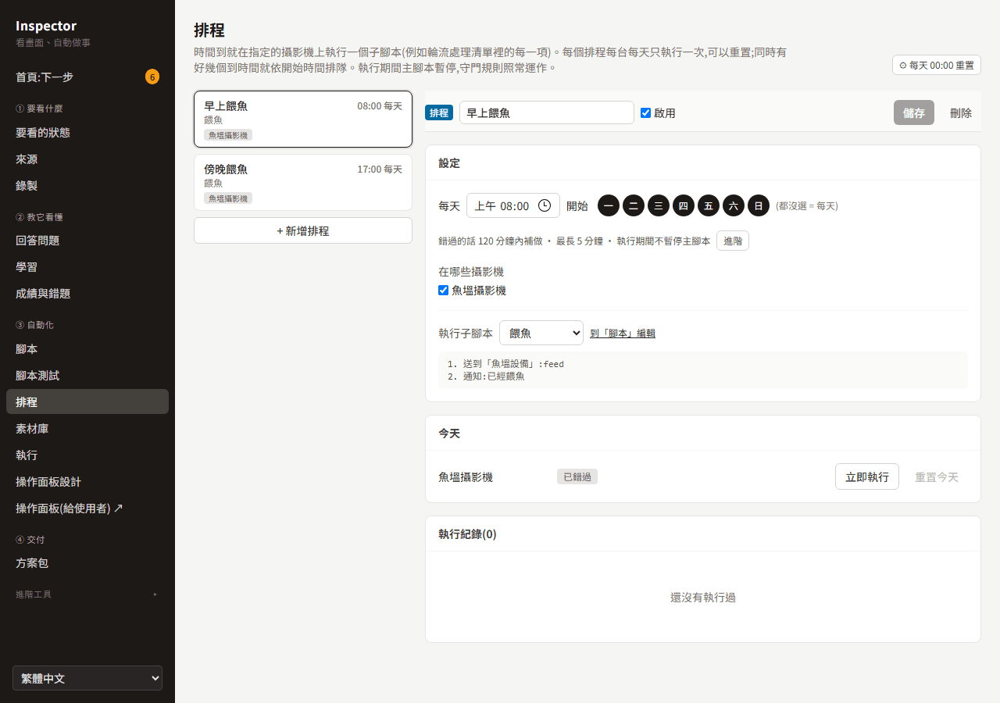

## 11. 操作面板:給現場的人用

**③ 自動化 › 操作面板設計**

現場的人不需要看腳本和狀態,只要看「現在怎樣」、按幾個按鈕、改幾個設定。操作面板就是給他們的頁面,手機也能用。

1. 「+ 新增設定區塊」,一個區塊是一件事:
   - 「設備」:加幾個動作按鈕(**接到 → 按下就執行子腳本**:開打氣機、關打氣機、開抽水、現在餵魚…);
   - 「水位」:接到使用者設定「低於這個水位就抽水」「高於這個水位就停止」;
   - 「餵食時間」:接到排程的開關和開始時間。
2. 「或新增監看元件:」加「裝置狀態」(看每台現在怎樣,勾「即時小畫面」)、「紀錄」、「通知與指令」(Discord / Telegram)。
3. 用「分頁」把區塊分到「現況」「設定」「通知」。

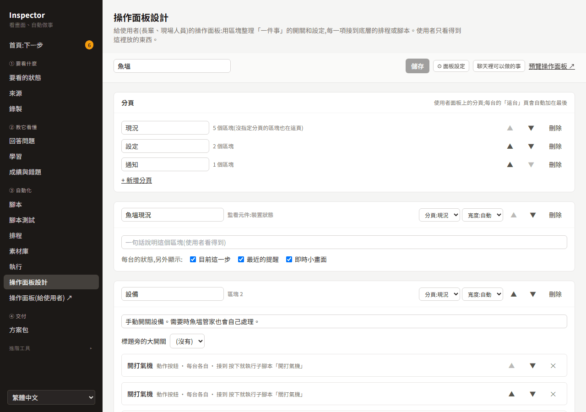

**操作面板(給使用者) ↗** 就是現場的人看到的樣子:

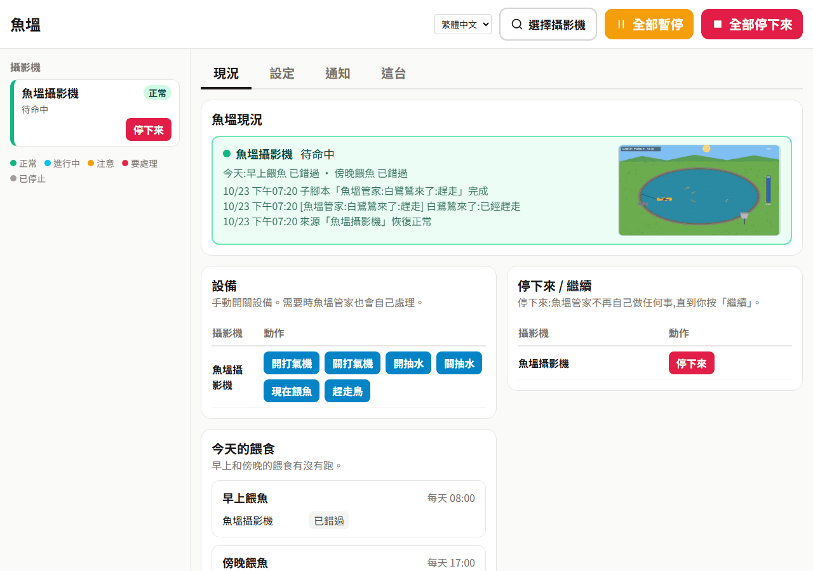

## 12. 匯出方案包,裝到另一台

**④ 交付 › 方案包**

1. 「匯出發行版」:確認名稱、版本(例如 `1.0.0`)、說明,看一下檢查結果(打 ✗ 的要先處理),按「匯出」,再按「下載」。
2. 到另一台電腦(裝 **Runtime** 就夠,不用 PyTorch):**方案包 › 安裝或升級**,選這個 zip,依提示重新啟動。
3. 在那台的「來源」接上攝影機,「執行 › 開始」。使用者在操作面板改的設定存在那台電腦上,之後安裝新版方案包也會保留。

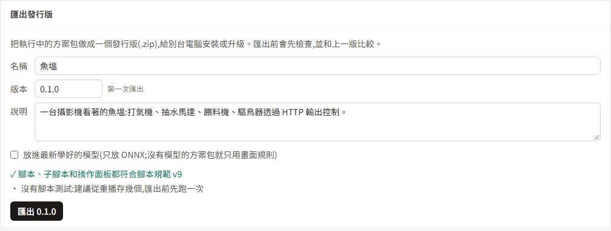

---

**接下來**

- 想讓別人也能直接裝好就用,方案包可以在 `project.json` 宣告它用到的來源(例如攝影機位址)和建議的執行方式,見魚塭、[小農場](https://github.com/wrbyhaquc/inspector-demo-farm)、[打地鼠](https://github.com/wrbyhaquc/inspector-demo-whack-a-mole) 的 `pack/build.py`。
- 兩台以上畫面不同的攝影機:狀態可以設「只用在這些來源」(小農場)。
- 要點擊畫面(App、模擬器、視窗)而不是控制設備:來源本身就是「手」,子腳本用「點擊」步驟,位置存在素材庫的「按鈕」(打地鼠)。
- 各部分的完整說明在 [README](../README.zh-TW.md) 和 [腳本說明](scripts.zh-TW.md)。
